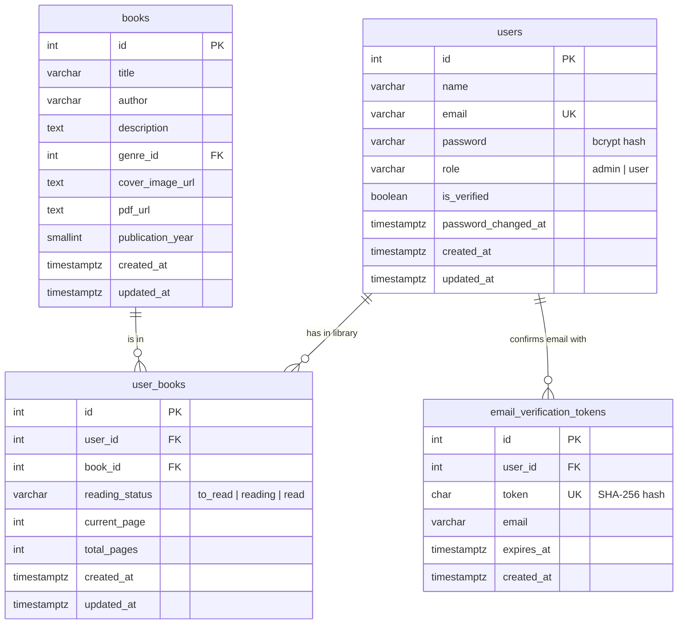

# BookTracker — Backend

REST API for BookTracker, built with Node.js, Express and PostgreSQL. It handles accounts with email verification, the book catalogue, each reader's personal library, reading progress, profiles and the admin dashboard.

The full list of endpoints, with request and response examples, is in [API.md](API.md).

## Requirements

- **Node.js 20 or newer** (Nodemailer, used for emails, no longer supports Node 18)
- **PostgreSQL 13 or newer**, running locally or hosted

## Getting started

1. **Install the dependencies**

   ```bash
   cd backend
   npm install
   ```

2. **Create your `.env` file** by copying the template:

   ```bash
   cp .env.example .env        # Windows PowerShell: Copy-Item .env.example .env
   ```

   Then open `.env` and set at least:
   - `DB_PASSWORD`: your PostgreSQL password.
   - `JWT_SECRET`: a long random secret. Generate one with
     `node -e "console.log(require('crypto').randomBytes(48).toString('hex'))"`.
   - `ADMIN_EMAIL` and `ADMIN_PASSWORD`: the first administrator account.

   `.env` is listed in the root `.gitignore`. Never commit it.

3. **Create the database and tables**

   ```bash
   npm run db:init
   ```

   This creates the `booktracker` database if it does not exist, then all tables, constraints, indexes and triggers from [database/schema.sql](database/schema.sql). It is safe to run again.

4. **Add the sample books and the admin account**

   ```bash
   npm run db:seed           # 10 public-domain classics with covers and PDFs
   npm run db:create-admin   # uses ADMIN_NAME, ADMIN_EMAIL, ADMIN_PASSWORD
   ```

5. **Start the API**

   ```bash
   npm run dev               # restarts automatically when you edit a file
   ```

   Open <http://localhost:4000/api/health>. You should see `{"status":"ok","database":"connected"}`.

## Scripts

| Command                   | What it does                                                    |
| ------------------------- | --------------------------------------------------------------- |
| `npm run dev`             | Starts the API and restarts it when files change                |
| `npm start`               | Starts the API (production)                                     |
| `npm run db:init`         | Creates the database (if missing) and all tables                |
| `npm run db:seed`         | Adds the sample books (skips books that already exist)          |
| `npm run db:create-admin` | Creates the admin from `.env`, or promotes an existing account  |

## Project structure (MVC)

```text
backend/
├── database/
│   ├── schema.sql            Tables, constraints, indexes, triggers
│   └── seed-books.json       Sample catalogue
├── scripts/                  db:init, db:seed, db:create-admin
├── postman/                  Postman collection for manual testing
└── src/
    ├── server.js             Starts the server after checking config and database
    ├── app.js                Express app: security headers, CORS, JSON, routes
    │
    ├── models/               Model: all SQL queries (data access)
    ├── views/                View: what the API sends back (JSON shapes, email HTML)
    ├── controllers/          Controller: business logic for each feature
    ├── middleware/           Checks around the controllers: login, roles, rate limit, errors
    │   └── validators/       Input rules for each request
    │
    ├── routes/               URL → middleware → controller
    ├── config/               Environment variables, PostgreSQL pool, mailer
    ├── services/             Email verification tokens and sending
    └── utils/                Password hashing, JWT, error class
```

A request flows like this: **route → `authenticate` → `authorize(role)` → `validate` → controller → model → PostgreSQL**, and the controller answers through a view. Errors from any step end up in `middleware/errorHandler.js`, which turns them into a consistent JSON response.

The screens people see are the React app in [`../frontend`](../frontend). `views/` is the backend's part of the View: it decides exactly what each answer contains (a user, for example, never includes the password hash) and the HTML of the emails.

## Database



Design choices:

- **`user_books` has a unique `(user_id, book_id)` pair**, so a book can only be in a library once, and each reader's progress is a separate row.
- **Deleting a user** removes their library and tokens (`ON DELETE CASCADE`). **Deleting a book** is blocked by the database while readers have it (`ON DELETE RESTRICT`); the API asks the admin to confirm, then removes the library entries and the book in one transaction.
- **CHECK constraints** guard the data even if the application has a bug: valid roles and statuses, lowercase emails, pages never beyond the total, sensible publication years.
- **`updated_at` is set by triggers**, so it is always correct whatever code updates a row.
- **Verification tokens are stored hashed.** Someone reading the database cannot use them. The `email` column records which address a token confirms, which also handles email changes.
- **`password_changed_at`** lets the API reject login tokens issued before a password change.

## Emails

**In development**, leave `SMTP_HOST` empty. Emails are printed in the server console instead of being sent, so you can copy the verification link from there.

**To send real emails with Gmail:**
1. Turn on 2-Step Verification for the Google account.
2. Create an app password at <https://myaccount.google.com/apppasswords>.
3. Set the following in `.env`:

```env
SMTP_HOST=smtp.gmail.com
SMTP_PORT=465
SMTP_SECURE=true
SMTP_USER=your.address@gmail.com
SMTP_PASS=the 16-character app password
MAIL_FROM="BookTracker <your.address@gmail.com>"
```

In production (`NODE_ENV=production`), the server refuses to start without SMTP settings.

Verification links point to the frontend: `CLIENT_URL/verify-email?token=…`. The frontend page reads the token and sends it to `POST /api/auth/verify-email`.

## Security

| Measure                         | Where                                                                   |
| ------------------------------- | ----------------------------------------------------------------------- |
| Passwords hashed with bcrypt (cost 12) | `utils/security.js`                                              |
| JWT login tokens (HS256, 1 day by default); the role is re-read from the database on every request | `middleware/auth.js` |
| Role-based access (`authorize('admin')`, `authorize('user')`) | `routes/*`                                |
| Unverified accounts cannot log in or use protected routes | `controllers/authController.js`, `middleware/auth.js` |
| Readers only ever reach their own library: queries always use the id from the token | `models/userBookModel.js` |
| Every input validated; SQL always parameterised | `middleware/validators/`, `models/`                           |
| The password hash is never sent to the browser | `views/userView.js`                                             |
| Rate limiting on `/api/auth` routes | `middleware/rateLimit.js`                                           |
| Security headers (Helmet), CORS limited to `CLIENT_URL` | `app.js`                                        |
| Changing the password signs out other devices | `controllers/profileController.js`                     |
| Secrets only in `.env`; error responses never expose internals in production | `config/env.js`, `middleware/errorHandler.js` |

**Optional: restricted database user.** Instead of connecting as the `postgres` superuser, create a user that can only work with BookTracker's data. Run this in pgAdmin while connected to the `booktracker` database, after `npm run db:init`:

```sql
CREATE ROLE booktracker_app LOGIN PASSWORD 'choose-a-strong-password';
GRANT CONNECT ON DATABASE booktracker TO booktracker_app;
GRANT USAGE ON SCHEMA public TO booktracker_app;
GRANT SELECT, INSERT, UPDATE, DELETE ON ALL TABLES IN SCHEMA public TO booktracker_app;
```

Then set `DB_USER=booktracker_app` and its password in `.env`. Keep using `postgres` for `npm run db:init`, which needs to create tables.

## Testing with Postman

Import [postman/BookTracker.postman_collection.json](postman/BookTracker.postman_collection.json) into Postman.

- The **Log in** requests save the token automatically.
- The other requests reuse the saved token, so run a login first.
- The `baseUrl` collection variable defaults to `http://localhost:4000/api`.

## Troubleshooting

| Message | Fix |
| ------- | --- |
| `nothing is answering at localhost:5432` | PostgreSQL is not running, or `DB_HOST`/`DB_PORT` are wrong. |
| `PostgreSQL rejected the password` | Check `DB_USER` and `DB_PASSWORD` in `.env`. |
| `database "booktracker" does not exist yet` | Run `npm run db:init`. |
| `JWT_SECRET must be set` | Add a secret of at least 32 characters to `.env`. |
| Browser shows a CORS error | `CLIENT_URL` must match the address the frontend runs on, e.g. `http://localhost:5173`. |
| `EADDRINUSE` on start | Another program uses port 4000. Change `PORT` in `.env`, and update the frontend's API URL. |
